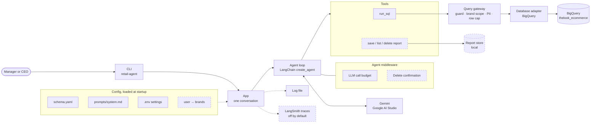
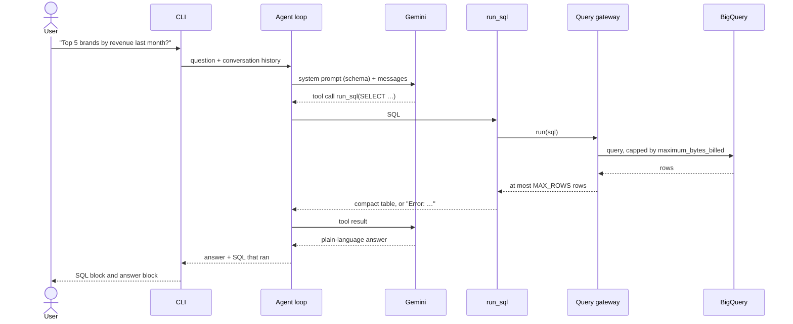

# High-level design: Retail data agent

A CLI chat agent that answers retail analytics questions in plain language over BigQuery's public `thelook_ecommerce` dataset (`orders`, `order_items`, `products`, `users`). It writes and runs SQL, explains the result, and never exposes customer PII or data outside the user's brands.

This document covers only what is decided. Each component is marked **built** (in the code today) or **planned** (decided, not built yet). The build order lives in [plan.md](plan.md).

## Architecture

Dashed boxes are planned. The gateway box is built, but its guard, scoping and PII layers are planned (it passes queries through with a row cap today).

## Components

| Component | Responsibility | Where | Status |
|---|---|---|---|
| CLI | Chat loop in the terminal. Prints each answer with the SQL that produced it; a failed question prints a clear message and the loop keeps running. | `cli.py` | built |
| App | One conversation per CLI run. Sends a question to the agent and returns the answer plus the SQL that ran. | `app.py` | built |
| Agent loop | The model ↔ tools loop, from LangChain `create_agent` (LangGraph underneath). Remembers earlier turns through a checkpointer. | `agent.py` | built |
| LLM | A LangChain chat model built from config (`<provider>:<model>`). Default `google_genai:gemini-3.8-flash`. | `llm.py` | built |
| Call budget | Ends a question after `MAX_LLM_CALLS` model calls (default 5; a normal question uses 2) to stay within Gemini's free tier. | `agent.py` | built |
| `run_sql` tool | Runs one query through the gateway. Returns a compact table to the model, or `Error: …` so the model can fix its SQL. | `tools.py` | built |
| Query gateway | The only path from the agent to the data. All data policy lives here, independent of the agent framework. | `gateway.py` | built (pass-through + row cap) |
| Database adapter | Driver only, behind a small `Database` protocol. The BigQuery adapter sets `maximum_bytes_billed` on every job. | `db/` | built |
| Schema | `schema.yaml`: tables, columns, types and short notes, rendered into the system prompt once at startup. | `schema.py` | built |
| Report tools and store | Save, list and delete reports. A report holds the question, the SQL and the answer, plus its owner, conversation id and creation time. | — | planned |
| Delete confirmation | Code (not the model) shows the exact reports to be deleted and waits for typed confirmation before a hard delete. | — | planned |
| Observability | Log file of questions, LLM calls and SQL today; LangSmith tracing on top. | `observability.py` | log file built, LangSmith planned |

## How a question is answered

If the SQL fails, the error goes back to the model, which sends corrected SQL. Every round counts against the call budget, so a bad question can't loop or run up cost.

## Key decisions

| Decision | Why |
|---|---|
| **LangChain `create_agent`** as the agent framework. | Gives the model ↔ tools loop, checkpointing and interrupts. Agent-level concerns (call budget, delete confirmation) attach as middleware. Heavier options (Deep Agents) add tokens and latency for a job of 1–3 tool calls per question. |
| **Gemini by default, provider set in config.** | The client's reviewers test with a free Gemini AI Studio key. Switching provider is a config change through `init_chat_model`; Anthropic, OpenAI and Azure OpenAI are available as optional extras but switched off. |
| **All data policy in the query gateway, not in middleware or the prompt.** | One choke point that the model can't talk its way around, and it doesn't depend on the agent framework. Pattern-matching PII middleware was rejected by the client as not robust. |
| **Own `Database` protocol and BigQuery adapter**, not SQLAlchemy. | Keeps BigQuery features we rely on: per-job byte caps, dry-run byte estimates and job stats. Another engine means another adapter. |
| **Schema in `schema.yaml`, prompt in `prompts/system.md`.** | Column notes give the model meaning that raw metadata lacks, with no extra round trip per question. The prompt is a file, so persona and tone change without touching code. |
| **Compact text tables as tool results.** | Fewer tokens than JSON rows; values formatted plainly, with a footer when a result is cut off or empty. |

## Safety

Each layer is enforced in code; the prompt is only the first line.

| Layer | What it does | Status |
|---|---|---|
| Cost cap | `maximum_bytes_billed` on every BigQuery job. | built |
| Row cap | At most `MAX_ROWS` rows (default 50) reach the model. | built |
| Analysis only | The system prompt refuses off-topic requests and attempts to override instructions, reveal the prompt or change data. | planned |
| Query guard | The parsed query must be a single SELECT over the 4 allowed tables. A dry run rejects anything above the byte limit before it costs anything. | planned |
| Brand scoping | The user is picked at CLI start (`--user`); a config file maps users to brands, and the CEO sees all. The gateway restricts every query to the user's brands, so orders and customers are reachable only through purchases of in-scope products. | planned |
| PII protection | PII columns are tagged in `schema.yaml` and blocked based on the parsed query, not name matching; results are checked again before rows reach the model. Never shown: first and last name, email, street address, postal code, exact coordinates, IP address. | planned |
| Pseudonyms | `user_id` is replaced by a stable salted-hash pseudonym, so follow-up questions about one customer still work. | planned |
| Aggregate-only fields | City, state, country, age, gender and traffic source appear only in aggregates, and groups smaller than `MIN_GROUP_SIZE` (default 5, configurable) are hidden. | planned |
| Report ownership | Only a report's author can see or delete it, enforced in the store query. | planned |

Because masking happens in the gateway, PII never reaches the LLM, the logs or the traces.

## Reports and deletion

- Asked for a report (e.g. "create a report for Q1 including insights and action items for Q2"), the agent runs the queries it needs, sending independent queries together as parallel tool calls to stay within the call budget, then writes findings, insights and action items.
- Reports are saved to a local store with owner, conversation id and creation time.
- Deletion selects reports by content ("delete all reports mentioning Client X") or by conversation ("delete all the reports we made in this conversation").
- The model can only propose a deletion. Code shows the exact list and waits for explicit typed confirmation (a LangGraph interrupt) inside the chat, then hard-deletes. Cancelling leaves everything as it was and the chat continues.

## Resilience

| Failure | Handling | Status |
|---|---|---|
| Bad SQL | The error goes back to the model to fix, within the call budget. | built |
| Model busy or unreachable | 30 s timeout and 1 SDK retry per LLM call; the CLI prints a clear message and keeps running. | built |
| Outage mid-question | Unanswered tool calls get an error result, so the conversation stays usable for the next question. | built |
| Empty result | The model rechecks its filters within the same budget, then says plainly that nothing matched. | planned |
| Gemini 429 / 5xx | Backoff with jitter, then fall back to another Gemini model (`gemini-3.8-flash` → `gemini-3.5-flash-lite`, configurable). Fallback stays within Gemini. | planned |
| BigQuery transient errors | Timeouts and retries. | planned |

## Observability

- **Log file** (`logs/retail-agent.log`, built): each question, each LLM call with duration or error, each SQL statement with duration, rows and bytes processed.
- **LangSmith tracing** (planned): off by default so reviewers need no account; turned on with `LANGSMITH_TRACING=true`. Each question becomes one trace with every LLM call, tool call, SQL, latency and token count, tagged with user, model, bytes scanned and retries.

## External services

| Service | Use | Auth |
|---|---|---|
| Google AI Studio (Gemini) | LLM | `GOOGLE_API_KEY` |
| BigQuery | Public `thelook_ecommerce` dataset; queries billed to `GCP_PROJECT` | Application Default Credentials or `GOOGLE_APPLICATION_CREDENTIALS` |
| LangSmith | Tracing, optional | `LANGSMITH_API_KEY` |
