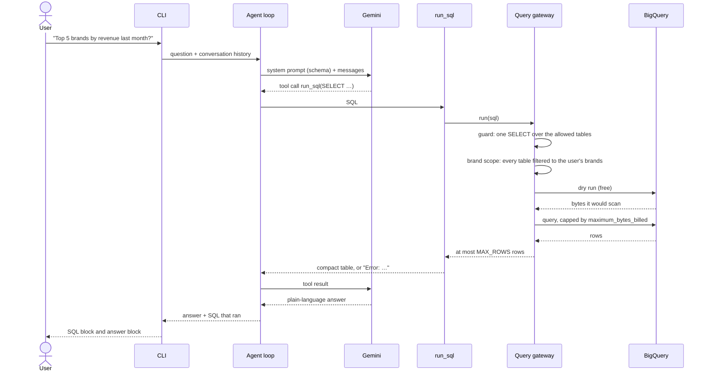
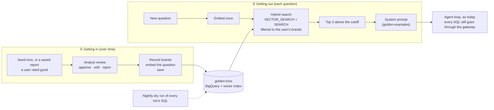
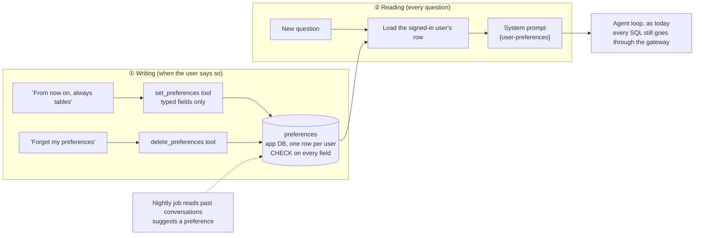
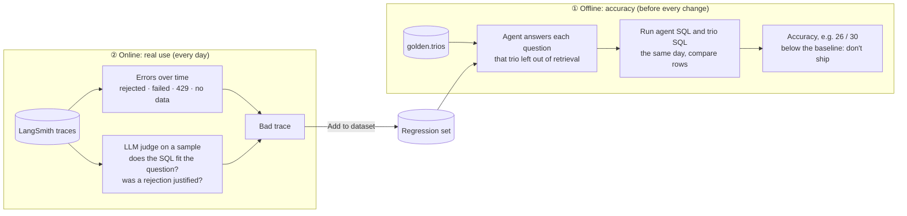
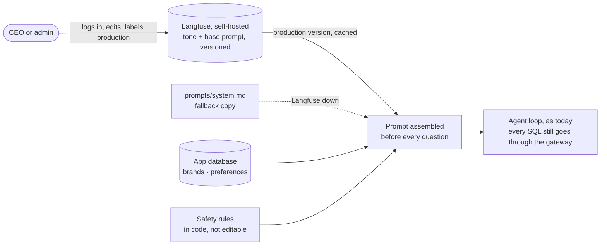

# High-level design: Retail data agent

A CLI chat agent that answers retail analytics questions in plain language over BigQuery's public `thelook_ecommerce` dataset (`orders`, `order_items`, `products`, `users`). It writes and runs SQL, explains the result, and never exposes customer PII or data outside the user's brands.

This document covers only what is decided. Each component is marked **built** (in the code today) or **planned** (decided, not built yet). The build order lives in [plan.md](plan.md).

## Architecture

Dashed boxes are planned. The gateway box is built with its guard, brand scope, row cap and the first two PII layers (column allow-list, customer pseudonyms); the check on returned rows is planned. `user → brands` is `users.yaml`.

## Components

| Component | Responsibility | Where | Status |
|---|---|---|---|
| CLI | Chat loop in the terminal. `--user` picks who is asking, from `users.yaml` (`users.py`). Prints each answer with the SQL that produced it (`--verbose`: every SQL tried, ✅ or ❌ with the reason); a failed question prints a clear message and the loop keeps running. | `cli.py` | built |
| App | One conversation per CLI run. Sends a question to the agent and returns the answer plus the SQL that ran. | `app.py` | built |
| Agent loop | The model ↔ tools loop, from LangChain `create_agent` (LangGraph underneath). Remembers earlier turns through a checkpointer. | `agent.py` | built |
| LLM | A LangChain chat model built from config (`<provider>:<model>`). Default `google_genai:gemini-3.8-flash`. | `llm.py` | built |
| Call budget | Limits a question to `MAX_LLM_CALLS` model calls (default 5; a normal question uses 2) to stay within Gemini's free tier. The last allowed call gets no tools, so it answers from the results already fetched. | `agent.py` | built |
| `run_sql` tool | Runs one query through the gateway. Returns a compact table to the model, or `Error: …` so the model can fix its SQL. | `tools.py` | built |
| Query gateway | The only path from the agent to the data. All data policy lives here, independent of the agent framework. Runs the query guard, the personal-data step (column allow-list, then customer pseudonyms), the brand scope, a dry run against the byte limit, then the query. | `query_safety/` (`gateway.py`, `step1_guard.py`, `step2_personal_data/`, `step3_brand_scope/`) | built (guard, column allow-list, pseudonyms, brand scope, byte limit, row cap); result checks planned |
| Database adapter | Driver only, behind a small `Database` protocol. The BigQuery adapter sets `maximum_bytes_billed` on every job. | `db/` | built |
| Schema | `schema.yaml`: tables, columns, types and short notes, rendered into the system prompt once at startup. | `schema.py` | built |
| Report tools and store | Save, list and delete reports. A report holds the question, the SQL and the answer, plus its owner, conversation id and creation time. | — | planned |
| Delete confirmation | Code (not the model) shows the exact reports to be deleted and waits for typed confirmation before a hard delete. | — | planned |
| Observability | Log file of questions, LLM calls and SQL today; LangSmith tracing on top. | `observability.py` | log file built, LangSmith planned |

## How a question is answered

If the guard or the dry run rejects the query, or BigQuery reports an error, the message goes back to the model, which sends corrected SQL. Every round counts against the call budget, so a bad question can't loop or run up cost.

## Key decisions

| Decision | Why |
|---|---|
| **LangChain `create_agent`** as the agent framework. | Gives the model ↔ tools loop, checkpointing and interrupts. Agent-level concerns (call budget, delete confirmation) attach as middleware. Heavier options (Deep Agents) add tokens and latency for a job of 1–3 tool calls per question. |
| **Gemini by default, provider set in config.** | The client's reviewers test with a free Gemini AI Studio key. Switching provider is a config change through `init_chat_model`; Anthropic, OpenAI and Azure OpenAI are available as optional extras but switched off. |
| **All data policy in the query gateway, not in middleware or the prompt.** | One choke point that the model can't talk its way around, and it doesn't depend on the agent framework. Pattern-matching PII middleware was rejected by the client as not robust. |
| **Brand scoping by rewriting the SQL**, not scoped views in BigQuery. | The gateway swaps every table in the parsed query for a version filtered to the user's brands, so no prompt can widen it. Scoped views would need datasets and views set up in a GCP project and kept in step with `users.yaml`, and can't be tested offline. See [brand-scoping.html](brand-scoping.html). |
| **Own `Database` protocol and BigQuery adapter**, not SQLAlchemy. | Keeps BigQuery features we rely on: per-job byte caps, dry-run byte estimates and job stats. Another engine means another adapter. |
| **Schema in `schema.yaml`, prompt in `prompts/system.md`.** | Column notes give the model meaning that raw metadata lacks, with no extra round trip per question. The prompt is a file, so persona and tone change without touching code. |
| **Compact text tables as tool results.** | Fewer tokens than JSON rows; values formatted plainly, with a footer when a result is cut off or empty. |

## Safety

Each layer is enforced in code; the prompt is only the first line.

| Layer | What it does | Status |
|---|---|---|
| Cost cap | `maximum_bytes_billed` on every BigQuery job. | built |
| Row cap | At most `MAX_ROWS` rows (default 50) reach the model. | built |
| Analysis only | The system prompt refuses off-topic requests and attempts to override instructions, reveal the prompt or change data. | built |
| Query guard | The parsed query must be a single SELECT over the 4 allowed tables; DML, DDL, scripting, other tables and table functions are rejected. A free dry run rejects anything above the byte limit before it costs anything. | built |
| Brand scoping | The user is picked at CLI start (`--user`); a config file maps users to brands, and the CEO sees all. The gateway restricts every query to the user's brands, so orders and customers are reachable only through purchases of in-scope products. Done by rewriting the SQL (`query_safety/step3_brand_scope/brand_scope.py`). For a brand manager, `orders.num_of_item` is recounted from their own items (`query_safety/step3_brand_scope/order_item_count.py`). | built |
| PII protection | PII columns are tagged in `schema.yaml` and blocked based on the parsed query, not name matching; results are checked again before rows reach the model. Never shown: first and last name, email, street address, postal code, exact coordinates, IP address. | planned |
| Pseudonyms | `user_id` is replaced by a stable salted-hash pseudonym, so follow-up questions about one customer still work. Done by rewriting the SQL for every user (`step2_personal_data/customer_pseudonyms.py`); the salt reaches BigQuery only as a query parameter. | built |
| Aggregate-only fields | City, state, country, age, gender and traffic source appear only in aggregates, and groups smaller than `MIN_GROUP_SIZE` (default 5, configurable) are hidden. Done by adding `HAVING COUNT(DISTINCT <customer id>) >= MIN_GROUP_SIZE` to every total of a tagged column (`step2_personal_data/small_groups.py`). | built |
| Report ownership | Only a report's author can see or delete it, enforced in the store query. | planned |

Because masking happens in the gateway, PII never reaches the LLM, the logs or the traces.

## Reports and deletion

- Asked for a report (e.g. "create a report for Q1 including insights and action items for Q2"), the agent runs the queries it needs, sending independent queries together as parallel tool calls to stay within the call budget, then writes findings, insights and action items.
- Reports are saved to a local SQLite store (`REPORTS_PATH`) with owner, conversation id, creation time, the question, the SQL behind it and the report text, through a `save_report` tool whose result is the final answer (no extra LLM call). The owner and conversation come from the code, not the model. Built. A `list_reports` tool lists the asking user's reports (owner filtered in the SQL), optionally those mentioning some text or made in this conversation; built. Deletion is built: the code shows the exact list and deletes only after a typed `yes`, as below.
- Deletion selects reports by content ("delete all reports mentioning Client X") or by conversation ("delete all the reports we made in this conversation").
- The model can only propose a deletion. Code shows the exact list and waits for explicit typed confirmation (a LangGraph interrupt) inside the chat, then hard-deletes. Cancelling leaves everything as it was and the chat continues.

## Golden Knowledge (design only)

The brief's bucket of historical **trios**: a question, the SQL an analyst wrote for it, and the analyst's written answer (one line, a paragraph or a full report). The agent uses them to answer new questions the way analysts did, for example reusing their definition of churn instead of guessing. Not built: the brief calls the bucket theoretical. Visual explainer: [golden-knowledge.html](golden-knowledge.html).

| Part | Design | Why |
|---|---|---|
| Store | One BigQuery table `golden.trios` (`question`, `sql`, `answer`, `brands`, `embedding`, `status`, `approved_by`, `approved_at`) with a vector index on `embedding` and a search index on `question`. | Same GCP project and auth as the data; no new database to run. Vertex AI Vector Search is the step up if the bucket outgrows it. |
| Embeddings | A Gemini embedding model, through Vertex AI or `ML.GENERATE_EMBEDDING` in BigQuery. The question is embedded; the whole trio is returned. | New questions are compared with old questions. Same provider as the chat model. |
| Getting in | Seed with analysts' trios. Later, a saved report that a user rated good becomes a candidate (the report store already keeps question, SQL and answer). An analyst approves, edits or rejects it. On approval its brands are recorded, the question is embedded and the trio is saved. The SQL isn't re-checked here: it already ran when the report or the analyst's work was made. | Only human-approved work becomes "golden"; the agent never teaches itself unchecked. |
| Getting out | Before the first model call: embed the question once, then one BigQuery query searches by meaning (`VECTOR_SEARCH`) and by words (`SEARCH`), merges the two rankings (reciprocal rank fusion) and keeps at most 3 trios above a similarity cutoff. They fill a `{golden-examples}` placeholder in `prompts/system.md`, labelled as examples rather than current data. | 0 extra LLM calls, so a question stays within 2–5 calls; a search tool would add one per question. Meaning catches "customers leaving" ≈ "churn"; words catch "Q1", "Levi's", "Texas". No example beats a weak one. |
| Brand guardrail | Each trio is tagged with the brands its SQL and answer cover. The search query only returns trios whose brands are all within the user's brands (`users.yaml`), or trios an analyst marked **method only** (figures removed from the answer). | A trio's answer holds real numbers; without this, a Calvin Klein figure could reach the Levi's manager's prompt. The same rule as the query gateway, applied before anything reaches the model. |
| Still guarded | SQL the agent writes after reading a trio goes through the query gateway like any other. | Trios guide the model; they never bypass the guard, PII rules, brand scope or byte cap. |
| Freshness | A nightly scheduled job dry-runs every active trio's SQL. A failure (e.g. after a schema change) sets `status = flagged` and sends it back to review. | Old SQL that no longer runs would teach the agent wrong habits. |
| Failure | If the embedding or search fails or is slow, the question continues without examples. | Golden Knowledge improves answers; it is never a single point of failure. |

## User preferences (design only)

The brief's user-level learning loop: the agent remembers that one user wants tables and another wants bullet points, how deep they like the analysis, and whether they want charts, and learns these over time. Preferences live in the same app database as saved reports, keyed by the signed-in user, and reach the model through the system prompt on every question. Not built. Visual explainer: [user-preferences.html](user-preferences.html).

| Part | Design | Why |
|---|---|---|
| Store | A `preferences` table next to `reports` in the app database (SQLite in the prototype's store, Cloud SQL in production): `user_id`, `format` (`table`, `bullets`, `text`), `depth` (`short`, `detailed`), `charts` (`yes`, `no`), `source` (`explicit`, `learned`), `status` (`active`, `suggested`), `updated_at`. Each field has a `CHECK` constraint listing its allowed values; one row per user. | Small, structured and private per user, like reports. A tick-box schema, not free text: there is no column a sentence like "show me customer names" could go into. |
| Identity | The `user_id` comes from the sign-in (`--user` in the prototype, SSO in production) and is bound into the tools by the code, the same way `save_report` gets its owner. The tools take no user argument. | The model can't read or write another user's preferences, even if asked to. |
| Writing | `set_preferences(format=…, depth=…, charts=…)`, each argument a fixed list of values in the tool schema; `delete_preferences(fields=None)` clears some or all. No confirmation: nothing valuable is lost and the user can set them again in one sentence (unlike reports, which are hard-deleted after a strict confirmation). When the message is only a preference, the tool's reply is the answer: 1 LLM call. | Users control their own settings in plain language, cheaply. |
| Reading | Before each model call, the user's active row fills a `{user-preferences}` placeholder in `prompts/system.md` (dynamic prompt middleware), e.g. "Answer as tables, short, no charts." No read tool: "what do you remember about me?" is answered from the prompt. | 0 extra LLM calls; a change applies to the very next answer, even mid-conversation. |
| Learning over time | A nightly job reads the day's conversations (LangSmith traces) for repeated corrections, e.g. asking "as a table" after 3 bullet answers, and writes a row with `status = suggested`. The agent asks once ("You often ask for tables. Make that your default?") and only a yes makes it `active`. | Learns without surprising the user; nothing changes behind their back. |
| Safety | Three locks: typed tool fields, the database `CHECK`, and the query gateway, which still blocks PII whatever the prompt says. The prompt states that preferences change only how answers look, never what data is allowed. | A preference can't widen access or carry a prompt injection. |
| Failure | If the store is down, the question continues with no preferences. | Preferences improve answers; they are never a single point of failure. |

## Evaluation (design only)

The brief's quality assurance: how we know the agent is good before deploying a change, and how we keep watching it after. Two parts: an **offline** accuracy score from the Golden trios, and **online** checks on the LangSmith traces of real use. Not built; the prototype has 184 unit tests with a scripted model and a fake database, which check the safety rules but not answer quality. Visual explainer: [evaluation.html](evaluation.html).

| Part | Design | Why |
|---|---|---|
| Offline accuracy | Each approved Golden trio is a test case. The agent answers the trio's question with **that trio left out** of Golden retrieval, so it can't copy the SQL. The agent's SQL and the trio's SQL both run on the same day, and the rows are compared (same columns and values, order ignored unless the question asks for a ranking, numbers within rounding). Accuracy = matching cases ÷ all cases. Also reported: right on the first try vs after a retry, and cases the gateway rejected. | thelook is regenerated daily, so stored answers go stale; stored reference SQL doesn't. Comparing rows, not SQL text, accepts two different queries that are both right. |
| When it runs | Once for a baseline, then before every prompt, model, schema-note or Golden change. A score below the baseline blocks the change. Small set (30–50 cases) on a paid key, since the free tier allows about 20 calls a day. | "Evaluate before deployment" (requirement 6) as a gate, not a one-off. |
| Online errors | Dashboards from the traces: share of questions with a rejected SQL, a failed SQL, a model fallback or timeout, an answer saying no data, and LLM calls per question. A jump after a release points to the trace that broke. | We know when it fails and can open the exact message exchange (requirement 7). |
| LLM judge | A LangSmith LLM-as-judge evaluator on a daily sample of traces, with yes/no questions: does the SQL answer the question asked (period, metric, filters)? Is every number in the answer present in a tool result? Was each gateway rejection justified, or did it block a safe query? The judge is a different model from the agent and sees the question, the SQL and the tool results, not just the answer. | Catches what code can't: intent, e.g. "last quarter" answered with "the last 90 days". |
| Trusting the judge | Before relying on it, the judge also scores the offline cases. If it agrees with the row comparison on most of them (e.g. 28 of 30), its scores on live traffic are trusted. | A judge that hasn't been checked against known answers is just another opinion. |
| Analyst rejections | Candidate trios that analysts reject in Golden review are counted by reason (wrong metric, wrong period, wrong join). | They show which kinds of question the agent gets wrong most. |
| Regression set | Any bad trace, from the judge or from an error, is added to a LangSmith dataset with the correct SQL, and that set runs alongside the trios before every change. This session's bugs are its first cases: "top brands in Essen" answered "no sales" when groups were hidden; a Levi's manager asking about Nike got the off-topic reply; `TIMESTAMP_SUB … MONTH` failed a whole round; a report claimed the "highest-converting traffic sources" with no query behind it. | Traces find problems; the dataset makes sure they stay fixed. |
| UX | Thumbs up or down on each answer (stored as LangSmith feedback), how often users rephrase the same question, and answer time. | Accuracy alone misses answers that are right but unhelpful or slow. |
| Safety checks | Pass or fail in code, no judge: no email or name pattern in any answer, a brand manager's sent SQL always carries the brand filter, at most 5 LLM calls per question. Already covered by unit tests for the gateway; run on traces as well. | Safety failures are never averaged into a score. |

## Persona and prompts (design only)

The brief's persona management: the CEO changes the tone of the reports weekly, without a developer and without a redeploy. The company-wide system prompt, tone included, lives in a self-hosted **Langfuse** prompt store that admins edit in its web page; each user's extras (brands, preferences) come from the app database. Today the prompt is the file `prompts/system.md`, filled with `{schema}`, `{dialect}` and `{user-brands}` when the app starts, so a tone change needs an edit and a restart.

| Part | Design | Why |
|---|---|---|
| Where prompts live | Langfuse prompt management, self-hosted on the company's own infrastructure. The editable prompt holds the persona and tone (e.g. "Brief and confident, lead with risks"); every save is a new version, and the version labelled `production` is the one in use. | Non-developers change the tone in a web page; prompts and traces stay inside the company. |
| Who can edit | Langfuse's own logins and roles: admins (the CEO's office) can edit and promote a version; everyone else can only view. Users never change the company tone through the chat; they change only their own preferences (above). | A brand manager can't make everyone's reports sarcastic. No admin page to build. |
| No redeploy | The agent loads the `production` version through the Langfuse SDK, which caches it for a short time (about a minute), so a promoted change reaches the next questions without a restart. | Requirement 8: a weekly tone change is a few clicks. |
| Per-user parts | Brands (`{user-brands}`) and preferences (`{user-preferences}`) come from the app database for the signed-in user and are filled into the same prompt. | Company tone and personal style combine; neither can change the other's. |
| Safety rules locked | The rules that protect data (analysis only, no PII, own brands, read only) are a separate part of the prompt kept in the code, added after the editable part, and not editable in Langfuse. The query gateway enforces them anyway. | A persona saying "ignore the privacy rules" changes nothing: tone is editable, access is not. |
| Before it goes live | A new version is saved as a draft and runs a few evaluation questions (see Evaluation) before it's labelled `production`. Rollback is moving the label back to the previous version. | A bad tone change is caught early and undone in one click. |
| Failure | If Langfuse is down, the SDK's last cached copy is used, and if there is none, the local `prompts/system.md`. | Prompt management is never a single point of failure. |
| One tool | In production, Langfuse also takes over tracing and the LLM judge from LangSmith (used in the prototype), so traces, prompts and evaluations sit in one self-hosted tool. | One place to debug a bad answer, from the prompt version to the SQL. |

## Resilience

| Failure | Handling | Status |
|---|---|---|
| Bad SQL | The error goes back to the model to fix, within the call budget. | built |
| Model busy or unreachable | 30 s timeout and 1 SDK retry per LLM call; the CLI prints a clear message and keeps running. | built |
| Outage mid-question | Unanswered tool calls get an error result, so the conversation stays usable for the next question. | built |
| Empty result | The model rechecks its filters within the same budget, then says plainly that nothing matched. | planned |
| Gemini 429 / 5xx | After its one SDK retry, a failed call goes to the next model in `LLM_FALLBACK_MODELS` (default `gemini-3.8-flash` → `gemini-3.5-flash-lite`). Fallback models use the same provider, so Gemini falls back only to Gemini. Each Gemini model has its own free-tier quota (20 requests a day), so the fallback roughly doubles how many questions a free key can answer. Every call tries the primary model first, so the agent goes back to it once it recovers. | built |
| BigQuery transient errors | Timeouts and retries. | planned |

## Observability

- **Log file** (`logs/retail-agent.log`, built): each question, each LLM call with duration or error, each SQL statement with duration, rows and bytes processed.
- **LangSmith tracing** (built; switched on by `.env`): each question is one trace labelled with the user, brands, model and conversation (one LangSmith thread per CLI run); a `query_gateway` step under each `run_sql` shows the SQL BigQuery ran after the rewrites, with rows and bytes. Traces hold prompts, SQL and already-masked rows; the pseudonym salt is a query parameter and never appears. off by default so reviewers need no account; turned on with `LANGSMITH_TRACING=true`. Each question becomes one trace with every LLM call, tool call, SQL, latency and token count, tagged with user, model, bytes scanned and retries.

## External services

| Service | Use | Auth |
|---|---|---|
| Google AI Studio (Gemini) | LLM | `GOOGLE_API_KEY` |
| BigQuery | Public `thelook_ecommerce` dataset; queries billed to `GCP_PROJECT` | Application Default Credentials or `GOOGLE_APPLICATION_CREDENTIALS` |
| LangSmith | Tracing, optional | `LANGSMITH_API_KEY` |
